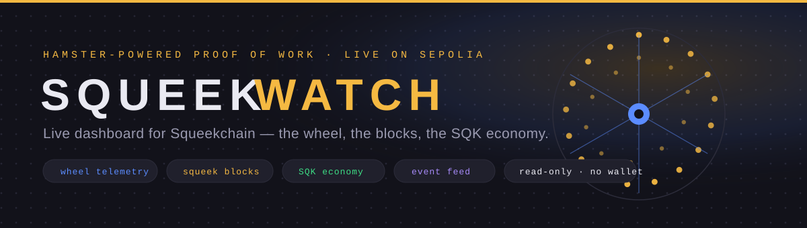

# SqueekWatch 🐹



**A live dashboard for [Squeekchain](https://squeekchain.com) — the hamster-powered proof-of-work toychain on Ethereum Sepolia.**

Watch Squeektoshi's wheel turn in real time, follow Squeek blocks as they complete, see settlements
land on Ethereum, and explore the whole SQK economy — all from one page, powered by the official
[Squeekchain public API](https://docs.squeekchain.com/developers/api/).

> Community project. Strictly read-only: no wallet connection, no signing, no keys.

---

## Features

| Section | What it shows | API endpoint |
| --- | --- | --- |
| **The Wheel** | Live RPM gauge, running speed, daily distance, device/Oracle/queue/settlement pipeline | `GET /v1/status` |
| **Squeek blocks** | Settled block height, difficulty, round countdown, next-block progress, provisional blocks | `GET /v1/core`, `GET /v1/measurement/blocks` |
| **Wheel activity** | 7-day work chart, "typical day" curve, records (top speed, peak RPM, longest streak…) | `GET /v1/measurement/stats?range=7d` |
| **Settlements & issuance** | Settlement batches, blocks per hour, SQK minted per settlement and checkpoint | `GET /v1/settlements?range=24h` |
| **SQK economy** | Supply vs 2.1B cap, mined/unminted, staking totals, Squeek level table | `GET /v1/economy/state` |
| **Live event feed** | Settlements, checkpoints, claims, stakes, merges, wheel milestones | `GET /v1/events` |
| **Account & Squeek lookup** | Rewards, power, staking and Squeek gallery for any address; on-chain artwork viewer | `GET /v1/accounts/{address}`, `GET /v1/squeeks/{tokenId}` |

Extra touches:

- **EN / 中文** — one-click language toggle in the header (English by default, so the review team
  sees an English app; 中文 for the community).
- **Honest numbers** — when the API answers `"status": "unavailable"`, the UI shows *unknown*,
  never zero. All big numbers are handled as `BigInt` (the API sends them as decimal strings).
- **Auto-refresh** with polling intervals tuned to the API's per-IP rate limits, plus a manual
  refresh button. Transient errors keep the last good data on screen.
- **Safe by design** — Squeek artwork is an on-chain SVG served as a data URI; it is rendered via
  `` and never injected as markup (per the docs' security guidance).
- **Zero chart libraries** — every chart and gauge is hand-rolled SVG/CSS, so the bundle stays
  tiny and installs are fast.

## Screenshots

<!-- TODO: run `npm run dev`, capture the dashboard and a Squeek card, save them into
     assets/ (e.g. assets/shot-dashboard.png) and replace the placeholders below. -->

| Dashboard | Squeek viewer |
| --- | --- |
|  | _screenshot coming after deploy_ |

## Tech stack

- [Vite](https://vitejs.dev) + [React 18](https://react.dev) + TypeScript (strict)
- No runtime dependencies beyond React. No SDK: the contracts and API speak for themselves.

## Quick start

```bash
npm install
npm run dev       # http://localhost:5173
npm run build     # type-check + production build into dist/
npm run preview   # serve the production build locally
```

## Deploy

### Vercel (recommended)

1. Push this repository to GitHub.
2. Import it at [vercel.com/new](https://vercel.com/new) — zero config, Vite is auto-detected.
3. Deploy. Done.

### GitHub Pages

A workflow is included at `.github/workflows/deploy.yml`. After pushing:

1. Repo **Settings → Pages → Source**: choose **GitHub Actions**.
2. Every push to `main` builds and publishes automatically (with the correct `BASE_PATH`).

## Project structure

```
src/
  App.tsx                  # polling wiring and page layout
  lib/types.ts             # response types for the Squeekchain API
  lib/api.ts               # fetch client (429/503 backoff) + contract addresses
  lib/format.ts            # BigInt-safe formatting for units, distances, time
  lib/i18n.tsx             # EN / 中文 dictionary and language context
  hooks/usePoll.ts         # polling hook with error resilience
  components/
    Header.tsx             # brand, live status pill, language toggle, refresh
    Hero.tsx               # banner with dot-matrix wheel art and live stats
    LivePanel.tsx          # wheel telemetry + pipeline stages
    ChainPanel.tsx         # Squeek blocks, difficulty, provisional blocks
    ActivityPanel.tsx      # 7-day charts and records
    SettlementsPanel.tsx   # settlements, hourly blocks, SQK issuance
    EconomyPanel.tsx       # supply, staking, Squeek levels
    EventFeed.tsx          # live event stream
    AccountLookup.tsx      # account + Squeek viewer
    Charts.tsx             # dependency-free bar/area/gauge charts
    ui.tsx                 # Panel / Stat / Chip primitives
```

## Data & rate limits

All data is read from `https://api.squeekchain.com/v1/…` (no API key, CORS-open). Polling
intervals in `src/App.tsx` respect the documented rate-limit classes (`publicFast` 30 req/s,
`publicHeavy` 5 req/s, stats cached 60 s). Chain data is served 12 confirmations behind the tip.

When building anything that prepares a transaction, read the contracts instead of the API — see
[Build owner actions](https://docs.squeekchain.com/developers/owner-actions/).

## 中文简介

SqueekWatch 是一个 Squeekchain（仓鼠驱动的工作量证明 "玩具链"）的实时数据看板：

- 🐹 实时跑轮遥测：RPM、速度、今日跑动距离、设备 → 预言机 → 结算队列 → 以太坊的完整流水线
- ⛓️ Squeek 区块：已结算高度、难度、区块进度、待结算的临时区块
- 🪙 SQK 经济：供应量 vs 21 亿上限、挖矿产出、质押、Squeek 等级表
- 📡 实时事件流 + 任意地址的账户/资产查询

纯只读、不连钱包、不签名；数据全部来自官方公开 API。右上角可一键切换 **EN / 中文** 界面。用 `npm install && npm run dev` 即可本地运行。

## Genesis · Code lane

This dashboard was built for the **Squeekchain Genesis — Code** track. It reads the protocol's
public data surface end to end (status, measurement, core, settlements, events, economy, accounts,
Squeeks) and is designed as a reference-quality integration example for other builders.

## Disclaimer

SqueekWatch is a community-built tool, not affiliated with or endorsed by the Squeekchain team.
Squeekchain is experimental testnet software; SQK has no established value. Nothing here is
financial advice. Use at your own risk.

## License

[MIT](./LICENSE)
